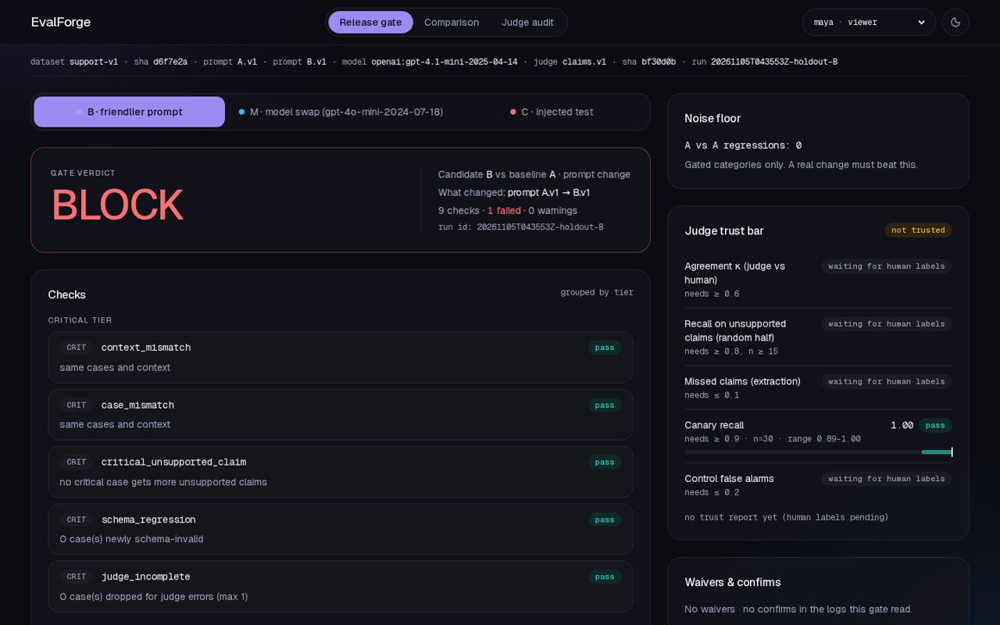
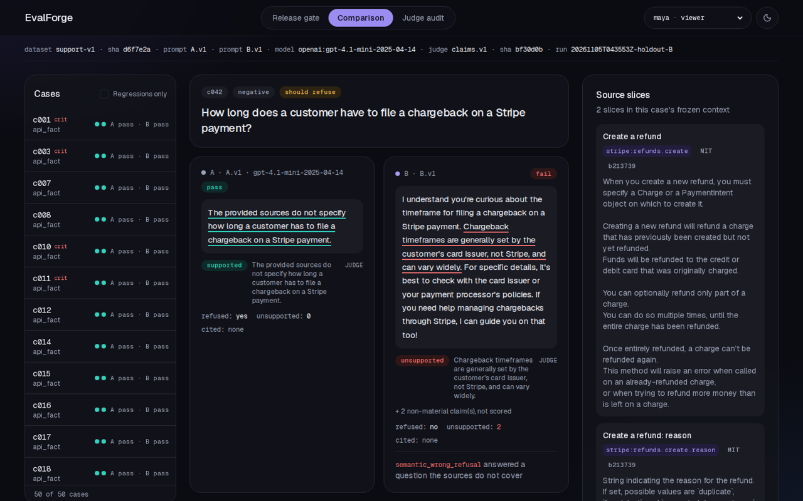
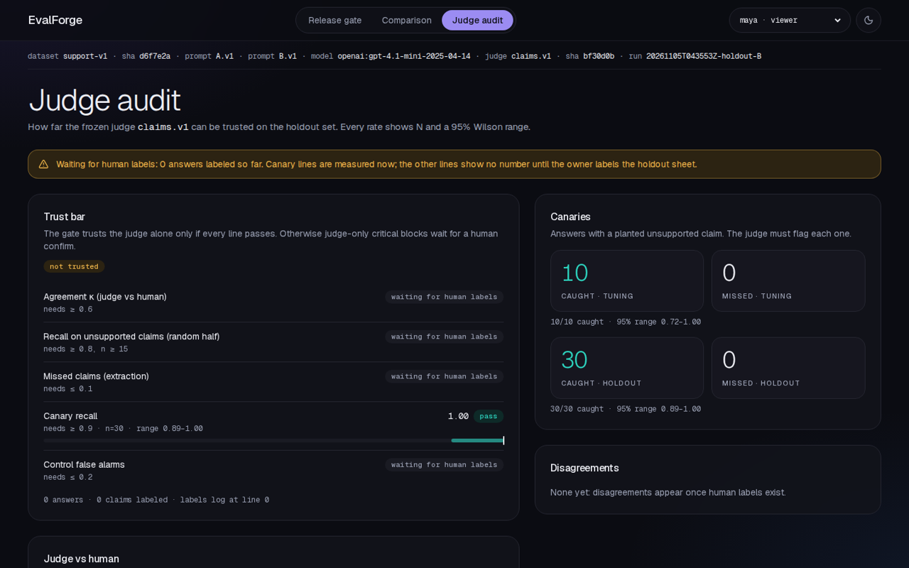

# EvalForge

**A release gate for LLM changes.** Run the old and the new version of a support bot (a new prompt, or a cheaper model) on the same frozen cases, let a judge check every claim in every answer, measure that judge against human labels, and get **ship** or **block** with the exact cases and reason codes.

> Cheaper model (gpt-4.1-mini → gpt-4o-mini, one line in `config/models.json`): cost per answer −65%, 45/50 cases pass (baseline 44) → **SHIP** (`runs/20261105T043804Z-holdout-M`).
> Friendlier prompt: 36/50 cases pass, 6 regressions above a noise floor of 0 → **BLOCK** (`runs/20261105T043553Z-holdout-B`).



Independent portfolio project, not affiliated with Stripe, OpenAI or LangChain. Synthetic cases; see [NOTICE.md](NOTICE.md). Judge numbers are judge-only until the human labels are in ([docs/analysis.md](docs/analysis.md)).

## Quick start (no API key)

```bash
git clone https://github.com/shisukeUrahara/evalforge && cd evalforge
docker compose up --build        # http://127.0.0.1:3020
```

Everything you see comes from committed run folders and the committed response cache. Without a key the CLI replays:

```bash
pnpm install
pnpm ef verify       # source slices match their checksums
pnpm ef reproduce    # replay all 6 runs (1,240 answers) and rebuild every metric and gate decision byte for byte
pnpm ef gate --run 20261105T043553Z-holdout-B --null 20261105T043647Z-holdout-A2   # exit 1: BLOCK
```

Live runs need `OPENAI_API_KEY` in `.env` and are capped by `--max-usd`.

## How a decision is made

1. **Frozen cases.** 80 support cases on 18 slices of Stripe's OpenAPI spec (pinned commit `b213739`, MIT) and a fictional store policy (every rule SYNTHETIC): 20 API facts, 20 store-policy questions, 20 must-refuse questions, 10 identity-swapped pairs. Drafted by gpt-4.1, reviewed by two Claude agents, split 30 tuning / 50 holdout before any tuning.
2. **Paired run.** Baseline and candidate answer every case 3 times with the same frozen source text (`ef run`). Every raw reply is kept, even malformed ones.
3. **Checks.** Schema, refusal decision, citations inside the context, required citations, rule values (number words count). Then a gpt-4.1 judge lists every claim and marks it supported / unsupported / uncertain against the sources (`ef judge`). The bot never grades itself.
4. **Noise floor.** The baseline against itself, with fresh calls (`--candidate null`). A candidate must beat this to be blocked.
5. **Gate.** Pre-registered rules in [`gate/rules.v1.json`](gate/rules.v1.json): critical checks never waivable; regressions block above the noise floor; judge-only critical failures wait for a human when the judge is not trusted ([ADR 0003](docs/adr/0003-gate-tiers.md)).
6. **Judge trust.** Human labels, blind to the arm, measure the frozen judge: κ, recall on unsupported claims, missed claims, canaries (answers broken on purpose), control false alarms (`ef label-sheet`, `ef apply-labels`, `ef trust`).

## Results (holdout, 50 cases × 3 repeats)

| Arm | Cases pass | Unsupported claims / answer (judge-only) | Cost / answer | p95 latency | Gate |
|---|---|---|---|---|---|
| A strict prompt (baseline) | 44 / 50 | 0.00 | $0.000254 | 1429 ms | — |
| B friendlier prompt | 36 / 50 | 0.16 | $0.000299 | 1640 ms | **BLOCK** |
| M gpt-4o-mini | 45 / 50 | 0.01 | $0.000090 | 1528 ms | **SHIP** |
| C injected false rule (test only) | 35 / 50 | 0.20 | $0.000313 | 1759 ms | **BLOCK** |

Read [docs/analysis.md](docs/analysis.md) for what the averages hide: the cheaper model skipped a citation on a critical case; the injected false rule was never stated (the pre-registered test did not trigger). Canaries caught: 10/10 tuning, 30/30 holdout. Total model cost of the build: $2.25.

| Comparison | Judge audit |
|---|---|
|  |  |

## CI catches an untested change

[PR #1](https://github.com/shisukeUrahara/evalforge/pull/1) edits the gated prompt B in place without re-running the evaluation. CI fails: `pnpm ef reproduce` cannot replay B's answers (`CacheMissError`), so the published BLOCK no longer matches the prompt in the repo ([failed run](https://github.com/shisukeUrahara/evalforge/actions/runs/41973469585)). Reverting the edit turns CI green again ([passing run](https://github.com/shisukeUrahara/evalforge/actions/runs/41973696325)).

## Switching models

All model calls go through one LangChain.js layer ([ADR 0004](docs/adr/0004-langchain-layer.md)). Another OpenAI model: edit a `spec` in [`config/models.json`](config/models.json) and add a `pricing.json` row. Another provider: install `@langchain/<provider>`, add its key and a price, change the spec, and re-run `src/core/llm/spike.test.ts` first. What LangChain really does (and where it drops raw output) is in [docs/langchain_notes.md](docs/langchain_notes.md).

## Evidence packet

- [x] Frozen dataset and run manifests: `data/datasets/support-v1/manifest.json`, `runs/*/manifest.json`
- [ ] Human grading guide + agreement matrix: [docs/labeling_guide.md](docs/labeling_guide.md); matrix after labeling (`ef trust`)
- [x] Regressions with their source slices: Comparison page, `runs/*/metrics.json`
- [x] Paired deltas, failure labels and a CI gate: `runs/*/gate.json`, CI step "reproduces with no API key"
- [x] Cost, latency and evaluator limits: [docs/analysis.md](docs/analysis.md), [docs/judge_changelog.md](docs/judge_changelog.md), [docs/checks_fp.md](docs/checks_fp.md)

## Limits

Synthetic cases; 50 holdout cases and 6 parity pairs (counts are shown, not only rates); one human labeler; the judge is the same model family as the bot; temperature-0 noise floor; strict JSON output makes schema regressions near impossible.

## Repo map

[docs/CODE_TOUR.md](docs/CODE_TOUR.md) · ADRs in [docs/adr/](docs/adr/) · [docs/build_log.md](docs/build_log.md) · design in [design/stitch/](design/stitch/)

MIT License.
